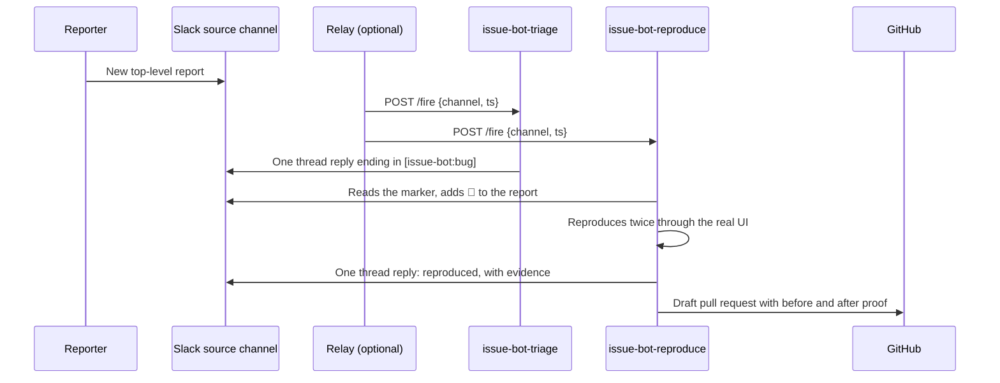

# Automations

This page covers how coder-stack runs work without you at the keyboard: which Claude Code surface starts a run, how to set the limits a run works inside (auto mode), and two worked setups. The **issue bot** triages Slack bug reports and reproduces them into draft pull requests. A **bot UI** is a page whose buttons start a cloud run.

## What can start a run

| Surface | Starts a run when | Runs where | coder-stack uses it for |
|---|---|---|---|
| `/loop` | An interval passes, or Claude's own pacing, inside one open session. Jobs expire after 7 days | Your session | The Autonomous run and Autopilot playbooks in `/coder-mode` |
| Desktop scheduled task | A local schedule fires while the Claude app is open | Your machine | Recurring local chores |
| Cloud scheduled task (formerly routine) | A schedule (hourly at most often), an HTTP POST to its API trigger, or a GitHub event | Anthropic's cloud, on a fresh clone | The issue bot, and bot UIs |
| GitHub Actions (`anthropics/claude-code-action`) | Any workflow event, or an `@claude` mention | A GitHub runner | Repo-local CI tasks |
| Channels (research preview) | An MCP server pushes an event into a session started with `--channels` | Your session | Not used yet |
| Claude in Slack | Someone mentions `@Claude` | Anthropic's cloud | Not used. It needs a mention, so it can't watch a channel |

Hooks are not on this list. A hook never starts a session. It runs inside one, on events such as `PreToolUse` or `Stop`, and can allow, deny, or add context. That makes hooks the place to enforce rules in an unattended run. The issue bot's Slack guard is one.

Cloud scheduled tasks are documented at [code.claude.com/docs/en/routines](https://code.claude.com/docs/en/routines). The API trigger's endpoint, headers, and payload wrapping are in the **make-bot-ui** skill.

## Define your auto mode

Auto mode lets a session run without permission prompts. A classifier allows or blocks each action, and blocks anything irreversible, destructive, or aimed outside your environment. A cloud scheduled task run starts in auto mode, unless auto mode isn't available to it, in which case it keeps the mode it launched in. An overnight `/loop` usually runs in auto mode too.

"Our auto mode" is the set of rules that classifier and the layers around it apply. Five layers decide whether an action runs. They don't all reach every surface:

| Layer | What it does | Local session | Cloud task run | GitHub Actions |
|---|---|---|---|---|
| `permissions.deny` in `.claude/settings.json` | Blocks the action before the classifier sees it | Yes | Yes, in single-repo runs outside a project | Yes |
| `permissions.ask` in `.claude/settings.json` | Forces a prompt, even in auto mode. A cloud run pauses until someone answers | Yes | Yes, in single-repo runs outside a project | No one can answer, so use `deny` |
| PreToolUse hooks in `.claude/settings.json` | Your own script allows, denies, or asks at call time | Yes | Yes, in single-repo runs outside a project | Yes |
| `CLAUDE.md` | The classifier reads it alongside Claude, so a rule here steers both | Yes | Yes | Yes |
| `autoMode` block | Trusted infrastructure in `environment`, plus `allow`, `soft_deny`, and `hard_deny` rules in prose | From `~/.claude/settings.json` | No. Only server-managed settings reach a cloud run | Pass it inline with `--settings` |

A scheduled task created inside a Claude project runs as a project thread. A project thread loads each repository's `CLAUDE.md` but none of its `.claude/settings.json` rules or hooks, and none of its skills or agents. Create a task outside any project when it depends on those.

Two limits follow from that table:

- **coder-stack can't ship an `autoMode` block.** A plugin's settings carry only `agent` and `subagentStatusLine`. Claude Code also ignores `autoMode` in a repository's `.claude/settings.json`, so a cloned repo can't widen what it is allowed to do.
- **A cloud run's limits live in the repository.** For cloud scheduled tasks, put hard lines in `permissions.deny` or a hook and soft rules in `CLAUDE.md`. Organization-wide rules go in server-managed settings.

### coder-stack's baseline for your own sessions

Run `/auto-mode-setup` once in a project you work in. It drafts `autoMode.environment` entries from the project and your recent sessions and writes them to `~/.claude/settings.json`. Then add coder-stack's rules beside the drafted ones. Keep `"$defaults"` in each list, or you replace the built-in rules. `/auto-mode-setup` writes `environment` without `"$defaults"`, so check its result with `claude auto-mode config` and add `"$defaults"` as the first entry if you want the built-in entries kept:

```json
{
  "permissions": {
    "ask": [
      "Bash(gh pr merge *)",
      "Bash(gh pr ready *)"
    ]
  },
  "autoMode": {
    "environment": [
      "$defaults",
      "Source control: github.com/<your-org> and every repository under it"
    ],
    "soft_deny": [
      "$defaults",
      "Never merge a pull request or turn on auto-merge. A person merges after review.",
      "Never post a root message in a Slack channel that an automation watches. Reply in the report's thread."
    ]
  }
}
```

The `ask` rules match coder-stack's shipping rule: an agent opens and updates pull requests, and a person approves the merge. They catch `gh pr merge` written plainly, not every way to merge, so the `soft_deny` line backs them up inside the classifier.

Check the result:

```bash
claude auto-mode config
```

```bash
claude auto-mode critique
```

`config` prints the rules the classifier uses. `critique` flags entries that are vague, redundant, or likely to block routine work. When auto mode blocks something you meant, open `/permissions`, go to **Recently blocked**, and press `r` to retry it. Add an `environment` entry when the same destination keeps getting blocked.

To start a session in auto mode, pass `claude --permission-mode auto` or press Shift+Tab. `permissions.defaultMode: "auto"` works only from user or managed settings, not from a project's settings files.

## Walkthrough: the issue bot

The issue bot is two cloud scheduled tasks that share one Slack channel. The pack is in [`automations/issue-bot/`](../automations/issue-bot/), and its README covers each task's contract.



Without a relay, both tasks run hourly and sweep the channel. Triage picks up reports with no verdict, and repro picks up triaged reports with no status reaction.

### Before you start

- A plan with cloud scheduled tasks: Pro, Max, Ultra, Team, or Enterprise.
- GitHub access for cloud sessions: the Claude GitHub App on the repository, or `/web-setup`.
- The Slack connector and your tracker's connector on your claude.ai account, at [claude.ai/customize/connectors](https://claude.ai/customize/connectors).
- An app the repro task can run headless in a cloud VM.

### Set it up

1. **Run the setup skill.** In the target repository, run `/coder-stack:setup-issue-bot`. It copies the pack to `.claude/automations/issue-bot/`. It also copies the two worker agents to `.claude/agents/`, and the coder-stack skills the runs use to `.claude/skills/`, since cloud runs don't install plugins. It writes `.claude/issue-bot/configuration.yaml` with your channel, tracker, and budgets.
2. **Give it a way to drive your app.** Setup offers `/create-verification-skill`. Its output, `.claude/skills/verify-<app>/` and that folder's feature map, is what the repro task drives. Add a setup script to the cloud environment that installs browsers and app dependencies. Then run the nine-step adapter check in a cloud session.
3. **Commit the guardrails.** Setup merges a PreToolUse hook into `.claude/settings.json` that runs on every Slack tool. A subagent may only read Slack. Besides reads, only posts, file shares, and reactions are allowed. In the source channel, posts and file shares must be thread replies. If the hook can't check a call, or crashes, the call is blocked. Setup also adds `ask` rules on merging, and appends the run boundaries to `CLAUDE.md`.
4. **Commit and push to the default branch.** Cloud runs clone the default branch, so nothing works until it's there.
5. **Create the two tasks** at [claude.ai/code/routines](https://claude.ai/code/routines), outside any Claude project, with the prompts setup drafted. A task in a project skips the repository's hooks, agents, and skills, so the Slack guard wouldn't run. Keep only the Slack and tracker connectors. Add an hourly schedule, an API trigger, or both. The API token is shown once. Store it in the relay's secret store, never in chat.
6. **Run the relay, if you want answers in minutes.** It is a small Slack app you run yourself. On each new top-level message in the source channel, it POSTs the message's coordinates to both Fire URLs, once each. Setup gives the exact body.
7. **Test with a harmless report.** Setup lists seven checks. The main ones: one verdict, in the thread, with one marker. No root post. Workers can't write to Slack. A deleted report produces nothing.

### Run it

- **Status** shows as reactions on each report: 👀 seen, 🔎 reproducing, ✅ reproduced, ⚪ could not reproduce, ⛔ blocked, 🛠️ fixing, ❌ fix failed, 🔗 pull request opened. They are configurable.
- **Each run** is listed on the task's detail page with a full transcript. In the CLI, `/schedule why did the triage task do nothing this morning?` reads the run log for you.
- **To pause**, turn the task off on its detail page. To cut off the relay, delete or regenerate the API token in the task's **Edit** dialog.
- **Limits:** 30 fires per hour per task, and runs count against your plan's usage. A busy channel needs the hourly sweep as a backstop.

### Reports in GitHub Issues instead of Slack

A cloud scheduled task can trigger on GitHub events directly, including **Issue** opened and labeled, so no relay is needed. The pack's operational files are written for Slack threads, and they would need a GitHub-issue version of the source-thread rules. That version isn't in the pack yet.

## Walkthrough: a bot UI

Run `/coder-stack:make-bot-ui` when you want a page or dashboard whose buttons start a cloud run. The skill walks through five steps:

1. Draft the task's saved prompt. It names the JSON fields the buttons send and treats the payload as untrusted.
2. Create the task with an API trigger at [claude.ai/code/routines](https://claude.ai/code/routines), and copy its Fire URL and token.
3. Write the token into the server's gitignored config yourself, with one clipboard command, so it never passes through chat.
4. Host the page on a local server that POSTs to the Fire URL, and probe it with a payload the prompt ignores.
5. Optionally, put the page on your tailnet.

Each click starts a full cloud session and returns its URL, so the person who clicked can watch the run.
